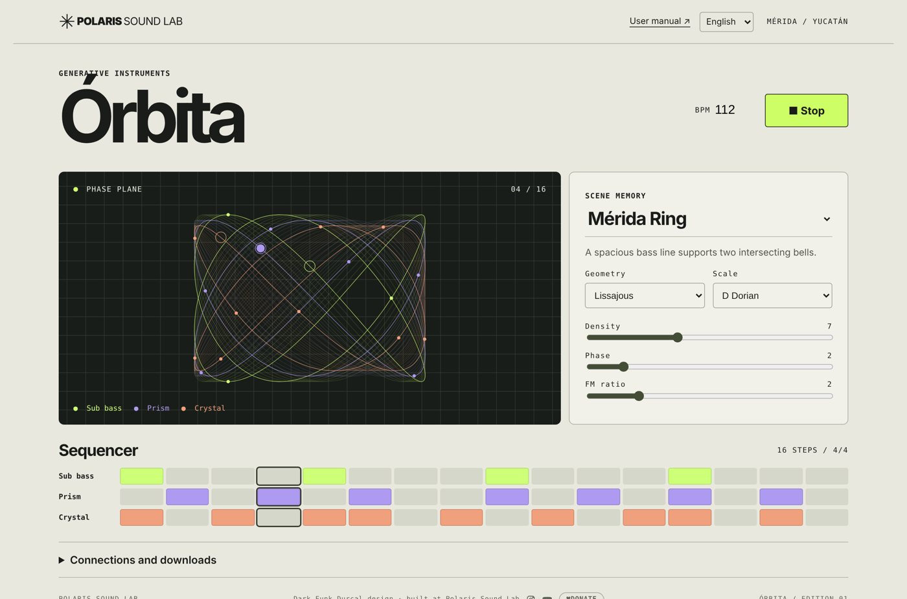

# ÓRBITA · Polaris Sound Lab

**A generative instrument: FM synthesis, euclidean rhythms and phase plots.** Three FM voices (a sub bass, a prism and a crystal) play euclidean rhythms over a scale, and the screen draws each voice as an orbit. Every note you hear is a point on its curve.

*Dark Funk Durcal design · built at Polaris Sound Lab, Mérida, Yucatán* · [Instagram](https://www.instagram.com/polaris.sound.lab/) · [YouTube](https://www.youtube.com/@PolarisSoundLab)

## Get it

| | | |
|---|---|---|
| 🌐 **Web** | Play now in your browser, on a computer or a phone. Nothing to install. | **[drophlex.github.io/ORBITA](https://drophlex.github.io/ORBITA/)** |
| 🎛 **Mac · Ableton Live** (VST3 · AU · App) | Open Terminal and paste: `curl -fsSL https://drophlex.github.io/ORBITA/install.sh \| bash` | [ORBITA-mac.zip](https://github.com/drophlex/ORBITA/releases/latest/download/ORBITA-mac.zip) |
| 🎹 **M-VAVE FM-1** | 32 DX7 voices to import with the M-VAVE Workbench, plus four MIDI scenes | [ORBITA-FM1.zip](https://github.com/drophlex/ORBITA/releases/latest/download/ORBITA-FM1.zip) |

**Step-by-step install guide with pictures: [drophlex.github.io/ORBITA/guide](https://drophlex.github.io/ORBITA/guide/)**

## Manual

17 illustrated pages, from installing to playing (web, Ableton Live, FM-1, recipes, answers):
**[English](docs/Orbita-EN.pdf)** · **[Español](docs/Orbita-ES.pdf)** · [English + Español](docs/Orbita-EN-ES.pdf)

## Quick guide

1. **Web**: press **▶ Play**, pick a **scene**, then move **Density** (how many hits in 16 steps), **Phase** (where they fall) and **FM ratio** (warm to metallic). Tap a voice's name to mute it. *Connections and downloads* exports a MIDI clip or plays your FM-1 over USB on channels 1–3.
2. **Ableton Live**: after installing, go to *Settings → Plug-ins → Use VST3 Plug-in System Folders → Rescan*, then drag **Polaris Orbita** onto a MIDI track. Turn on **Sequence with Live** and press play: *Pulses / 16* spreads the hits over the bar, following Live's tempo.
3. **FM-1**: in the [M-VAVE Workbench](https://open.m-vave.com/), **export your group first**, then import one voice from `voces/` (or `Orbita-32.syx` for all 32) and save it to the FM-1. Drag a clip from `escenas/` onto a Live track routed to the FM-1.

Everything is in English by default, with Spanish one click away: in the web header, in the plug-in's panel, and with EDIT on the fm1-dock module.

## What's in the repository

| Folder | |
|---|---|
| `docs/` | The web instrument (GitHub Pages), the install guide, `install.sh`, the manuals |
| `Orbita-VST3/` | Plug-in source (JUCE 8). The Mac build runs in GitHub Actions and is published in each release (pluginval and auval checks). `Construir-en-Mac.command` builds it yourself. |
| `Orbita-FM1/` | The 32 DX7 voices, the full bank, four MIDI clips and the source of an ÓRBITA module for the community firmware [fm1-dock](https://github.com/joakimeriksson/fm1-dock) |
| `tools/manual/` | The manual's sources (`shots.mjs` → `manual.py` → `pdf.mjs`) |

**Status.** The web version is complete. The plug-in is built and checked automatically on macOS, but it hasn't been played inside Live yet. The FM-1 voices passed format and checksum checks, but nobody has listened to them on a real FM-1 yet. The fm1-dock module is source only: it isn't built for the FM-1's JieLi chip yet and hasn't been tested on hardware.

---

### En español

**Un instrumento generativo: síntesis FM, ritmos euclidianos y gráficos de fase.** Tócalo en el navegador ([drophlex.github.io/ORBITA](https://drophlex.github.io/ORBITA/)) o en Ableton Live. Para instalarlo en Mac, pega en Terminal `curl -fsSL https://drophlex.github.io/ORBITA/install.sh | bash`. También puedes cargar sus 32 voces en tu M-VAVE FM-1 con el Workbench de M-VAVE: exporta primero tu grupo para no perder tus sonidos. Tienes la guía paso a paso en [drophlex.github.io/ORBITA/guide](https://drophlex.github.io/ORBITA/guide/) y el manual en [español](docs/Orbita-ES.pdf).

---

Free and open source · GPL-3.0 ([LICENSE](LICENSE)). JUCE keeps its own terms. If ÓRBITA is useful to you, you can support it with a [donation ♥](https://www.paypal.com/donate/?business=drophlex%40gmail.com&no_recurring=0&item_name=ORBITA&currency_code=USD).

M-VAVE and FM-1, Ableton and Live, and Yamaha and DX7 are trademarks of their owners. ÓRBITA isn't affiliated with or endorsed by them.
