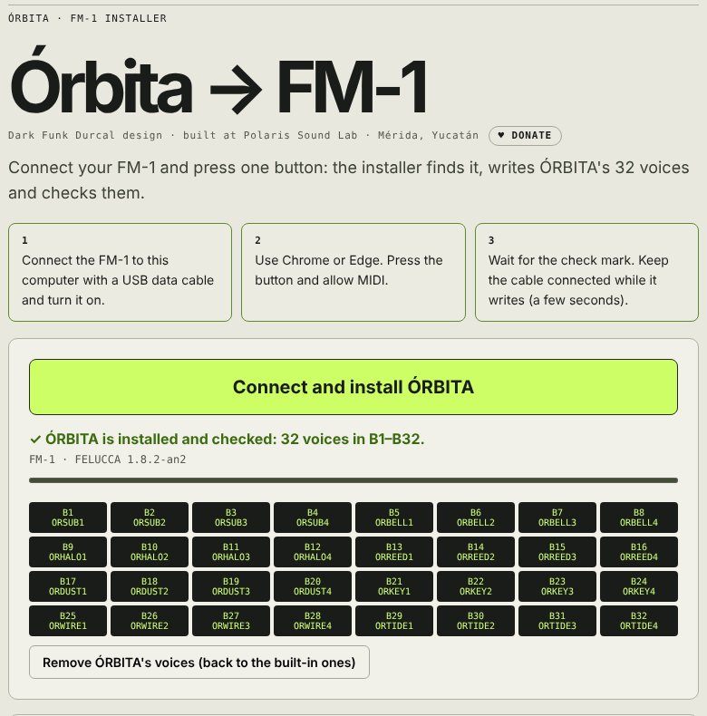
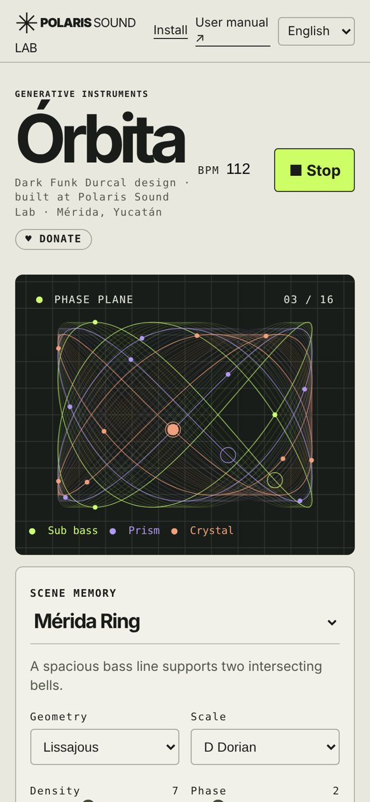

# ÓRBITA · Polaris Sound Lab

**A generative instrument: FM synthesis, euclidean rhythms and phase plots.** Four FM voices (a sub bass, a prism, a crystal and a halo) play euclidean rhythms over a scale, and the screen draws each voice as an orbit. Every note you hear is a point on its curve.

**ÓRBITA 2** is the same instrument on the web and in your DAW: one engine (WebAssembly in the browser, native in the plug-in) and one interface, so both sound and look exactly alike. New in 2: **GRAVITY** (glide the whole sound from one scene to another with one knob), **EVOLVE** (the orbit wanders by itself, never far from home), the **TIME MACHINE** (every change and every evolution is kept; click to go back), **HARMONY keys** (hold a chord and the orbit plays only those notes), per-voice **polymeter**, six voice models, a stereo echo, a deep reverb, **MIDI OUT** and **drag-a-clip** onto your tracks. The four classic scenes still play ÓRBITA 1's notes, note for note.

*Dark Funk Durcal design · built at Polaris Sound Lab, Mérida, Yucatán* · [Instagram](https://www.instagram.com/polaris.sound.lab/) · [YouTube](https://www.youtube.com/@PolarisSoundLab)

## Get it

| | | |
|---|---|---|
| 🌐 **Web** | Play now in your browser, on a computer or a phone. Nothing to install. | **[drophlex.github.io/ORBITA](https://drophlex.github.io/ORBITA/)** |
| 🎛 **Mac · Ableton Live** (VST3 · AU · App) | Open Terminal and paste: `curl -fsSL https://drophlex.github.io/ORBITA/install.sh \| bash` | [ORBITA-mac.zip](https://github.com/drophlex/ORBITA/releases/latest/download/ORBITA-mac.zip) |
| 🪐 **M-VAVE FM-1 · ÓRBITA firmware (beta)** | The whole instrument on the FM-1: the four scenes, the phase plane on its screen, the web's patterns and its own three voices. Connect the FM-1 by USB, open the installer in Chrome or Edge, press *Install*. It saves a backup and can return to the official firmware. | **[drophlex.github.io/ORBITA/firmware](https://drophlex.github.io/ORBITA/firmware/)** · [ORBITA-FM1.fwsc](https://github.com/drophlex/ORBITA/releases/latest/download/ORBITA-FM1.fwsc) |
| 🎹 **M-VAVE FM-1 · voices only** | Connect the FM-1 by USB, open the installer in Chrome or Edge and press one button. It writes the 32 voices and checks them. | **[drophlex.github.io/ORBITA/fm1](https://drophlex.github.io/ORBITA/fm1/)** · [ORBITA-FM1.zip](https://github.com/drophlex/ORBITA/releases/latest/download/ORBITA-FM1.zip) |

**Step-by-step install guide with pictures: [drophlex.github.io/ORBITA/guide](https://drophlex.github.io/ORBITA/guide/)**

## Manual

17 illustrated pages, from installing to playing (web, Ableton Live, FM-1, recipes, answers):
**[English](docs/Orbita-EN.pdf)** · **[Español](docs/Orbita-ES.pdf)** · [English + Español](docs/Orbita-EN-ES.pdf)

## Quick guide

1. **Web**: press **▶ Play**, pick a **scene**, then move **Density** (how many hits in 16 steps), **Phase** (where they fall) and **FM ratio** (warm to metallic). Tap a voice's name to mute it. *Connections and downloads* exports a MIDI clip or plays your FM-1 over USB on channels 1–3.
2. **Ableton Live**: after installing, go to *Settings → Plug-ins → Use VST3 Plug-in System Folders → Rescan*, then drag **Polaris Orbita** onto a MIDI track. Turn on **Sequence with Live** and press play: *Pulses / 16* spreads the hits over the bar, following Live's tempo.
3. **FM-1, the whole instrument (beta)**: install the [ÓRBITA firmware](https://drophlex.github.io/ORBITA/firmware/). PLAY starts it; PRESETS or OCT−/+ change the scene; knobs 1–4 are density, phase, FM ratio and scale; ALGO the geometry; SELECT the tempo; FX, SCL and ENV mute the three voices; LFO picks the voice set; EDIT switches English / Español. It was built and tested on a computer (its notes match the web's in all 42,480 cases, its voices match the web's sound, Felucca's full test suite passes) but not yet on a physical FM-1.
4. **FM-1, voices only**: open the [one-click installer](https://drophlex.github.io/ORBITA/fm1/) with the FM-1 on USB.
   - **ANDROMEDA, Dark Funk Durcal or Felucca:** the voices land on FM6 SLOT **B1–B32**. Pick a track, hold EDIT and press the 2nd white key (FM6), then turn HOME's KNOB 4. *Remove* brings the built-in voices back.
   - **Official M-VAVE firmware:** the FM-1 asks which bank (A–D) to save to.
   - You can also play the `escenas/` MIDI clips into it from Live.

Everything is in English by default, with Spanish one click away: in the web header, in the plug-in's panel, and with EDIT on the fm1-dock module.

## What's in the repository

| Folder | |
|---|---|
| `engine/` | ÓRBITA 2's engine: one C++ header (no libraries), built to WebAssembly for the web and natively for the plug-in |
| `ui/` | The interface (one page for the web and the plug-in); `tools/build_web.py` builds `docs/index.html` and `plugin/ui/index.html` |
| `plugin/` | The plug-in (JUCE 8: VST3 · AU · App). The Mac build runs in GitHub Actions with pluginval and auval. `Build-on-Mac.command` builds it yourself. |
| `test/` | Engine tests: ÓRBITA 1's notes and rhythms in every case, levels, sync, MIDI out |
| `docs/` | The web instrument (GitHub Pages), ÓRBITA 1 in `docs/classic/`, the install guide, `install.sh`, the manuals |
| `Orbita-FM1/` | The 32 DX7 voices, the full bank, four MIDI clips and the source of an ÓRBITA module for the community firmware [fm1-dock](https://github.com/joakimeriksson/fm1-dock) |
| `tools/manual/` | The manual's sources (`shots.mjs` → `manual.py` → `pdf.mjs`) |

**Status.** ÓRBITA 2's web edition and engine are tested in the browser and by the engine tests (every one of ÓRBITA 1's 82,944 note and rhythm cases matches). The plug-in is built and checked automatically (pluginval, auval), but it hasn't been played inside Live yet. The FM-1 installer was tested on a computer against the FM-1 firmware's own code (ANDROMEDA's) with `tools/fm1-check`: every reply, the names read back, each voice loaded and played, and *Remove*. It hasn't been tried on a physical FM-1 yet, nor on the official firmware. The fm1-dock module is source only: it isn't built for the FM-1's JieLi chip yet and hasn't been tested on hardware.

---

### En español

**Un instrumento generativo: síntesis FM, ritmos euclidianos y gráficos de fase.** ÓRBITA 2 es el mismo instrumento en la web y en tu DAW (un solo motor y una sola interfaz): cuatro voces, GRAVEDAD para deslizarte de una escena a otra, EVOLUCIÓN, la MÁQUINA DEL TIEMPO, teclas de ARMONÍA, polimetría, MIDI OUT y arrastrar clips a tus pistas. Tócalo en el navegador ([drophlex.github.io/ORBITA](https://drophlex.github.io/ORBITA/)) o en Ableton Live. Para instalarlo en Mac, pega en Terminal `curl -fsSL https://drophlex.github.io/ORBITA/install.sh | bash`. Para tu M-VAVE FM-1 hay un **[firmware ÓRBITA completo (beta)](https://drophlex.github.io/ORBITA/firmware/)**: las cuatro escenas, el plano de fase en su pantalla, los mismos patrones de la web y sus tres voces originales; se instala con un botón desde Chrome o Edge, guarda un respaldo y puede volver al firmware oficial (probado en computadora, aún no en un FM-1 físico). Si sólo quieres las voces, hay un **[instalador de un clic](https://drophlex.github.io/ORBITA/fm1/)**: conecta el FM-1 por USB, ábrelo en Chrome o Edge, pulsa el botón y él escribe y comprueba las 32 voces. Tienes la guía paso a paso en [drophlex.github.io/ORBITA/guide](https://drophlex.github.io/ORBITA/guide/) y el manual en [español](docs/Orbita-ES.pdf).

---

Free and open source · GPL-3.0 ([LICENSE](LICENSE)). JUCE keeps its own terms. If ÓRBITA is useful to you, you can support it with a [donation ♥](https://www.paypal.com/donate/?business=drophlex%40gmail.com&no_recurring=0&item_name=ORBITA&currency_code=USD).

M-VAVE and FM-1, Ableton and Live, and Yamaha and DX7 are trademarks of their owners. ÓRBITA isn't affiliated with or endorsed by them.
